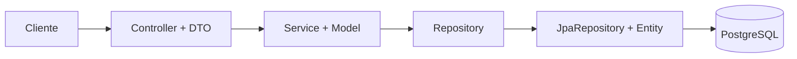
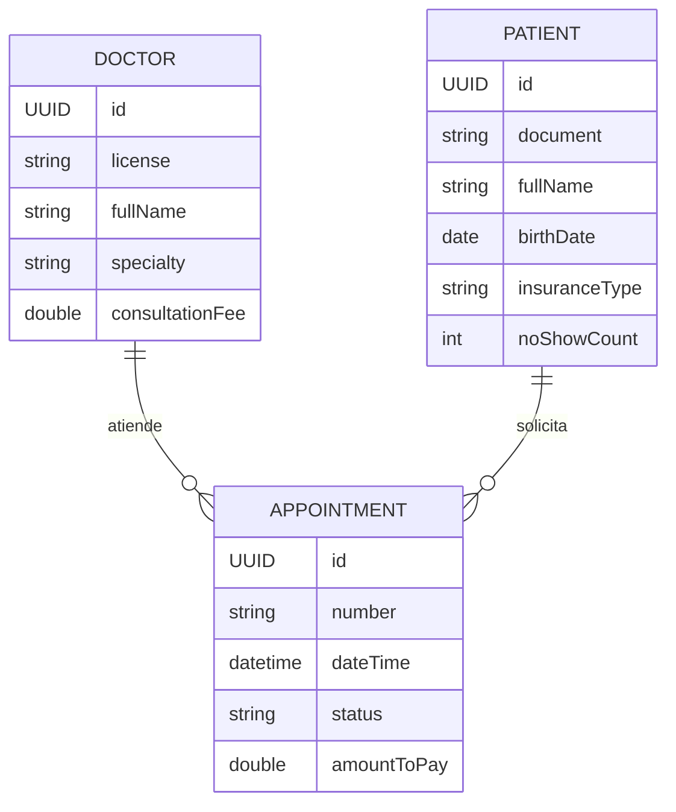

# Clínica – Sistema de citas médicas

API REST con Spring Boot (Java 21, Maven, PostgreSQL) para gestionar médicos, pacientes y citas.

## Arquitectura

```
com.example.clinica
├── controllers/   DoctorController, PatientController, AppointmentController
├── dtos/          <X>CreateDto, <X>UpdateDto, <X>ResponseDto
├── models/        Doctor, Patient, Appointment (+ enums InsuranceType, AppointmentStatus)
├── entities/      DoctorEntity, PatientEntity, AppointmentEntity
├── mappers/       DTO <-> Model <-> Entity (métodos estáticos)
├── repositories/  <X>Repository (extiende JpaRepository)
├── services/      <X>Service (lógica de negocio)
├── exceptions/    Excepciones propias + GlobalExceptionHandler
└── config/        ClockConfig
```



## Diagrama entidad-relación



## Cómo ejecutar

1. Crear la base de datos:
   ```sql
   CREATE DATABASE clinica;
   ```
2. Definir las variables de entorno (las credenciales **no** están en el repositorio).

   PowerShell (sesión actual):
   ```powershell
   $env:DB_USER="postgres"
   $env:DB_PASSWORD="tu_clave"
   ```
   Bash:
   ```bash
   export DB_USER=postgres
   export DB_PASSWORD=tu_clave
   ```
3. Verificar que `JAVA_HOME` apunte a un JDK 21 y ejecutar:
   ```bash
   ./mvnw spring-boot:run
   ```
4. Comprobar `http://localhost:8080/actuator/health` → `{"status":"UP"}`.

Pruebas: `./mvnw test` (pruebas unitarias del servicio con Mockito, no requieren base de datos).

## Endpoints

| Método | Ruta | Descripción |
|---|---|---|
| GET | `/api/doctor` | Listar médicos |
| GET | `/api/doctor/{license}` | Consultar por licencia |
| POST | `/api/doctor` | Crear |
| PUT | `/api/doctor/{license}` | Actualizar nombre, especialidad y tarifa |
| DELETE | `/api/doctor/{license}` | Eliminar (422 si tiene citas `SCHEDULED`) |
| GET | `/api/patient` | Listar pacientes |
| GET | `/api/patient/{document}` | Consultar por documento |
| POST | `/api/patient` | Crear |
| PUT | `/api/patient/{document}` | Actualizar nombre, fecha de nacimiento y seguro |
| DELETE | `/api/patient/{document}` | Eliminar |
| POST | `/api/appointment` | Agendar cita (RN1–RN7) |
| GET | `/api/appointment/{number}` | Consultar por número |
| GET | `/api/appointment?doctorLicense=&date=` | Citas de un médico en un día |
| GET | `/api/appointment/patient/{document}` | Historial de un paciente |
| PATCH | `/api/appointment/{number}/cancel` | Cancelar (RN8) |
| PATCH | `/api/appointment/{number}/attend` | Marcar atendida |
| PATCH | `/api/appointment/{number}/no-show` | Marcar inasistencia |

## Reglas de negocio

| # | Regla | Error |
|---|---|---|
| RN1 | Citas de 30 min, sólo en `:00` o `:30` | 422 |
| RN2 | Lunes a viernes, 8:00–17:00 (última cita 16:30) | 422 |
| RN3 | No agendar en el pasado | 422 |
| RN4 | Médico sin dos citas `SCHEDULED` en el mismo horario | 409 |
| RN5 | Paciente sin dos citas `SCHEDULED` el mismo día | 409 |
| RN6 | Valor a pagar: `NONE` 100 %, `BASIC` 50 %, `FULL` 0 % | – |
| RN7 | 2 o más `NO_SHOW` impiden agendar | 422 |
| RN8 | Cancelar sólo con más de 2 horas de anticipación | 422 |

## Códigos de error

`404` no existe · `409` duplicado/conflicto de agenda · `422` regla de negocio · `400` datos inválidos.

## Pruebas manuales

Importar `postman/Clinica.postman_collection.json` en Postman y ejecutarla con el *Collection Runner* (en orden).
